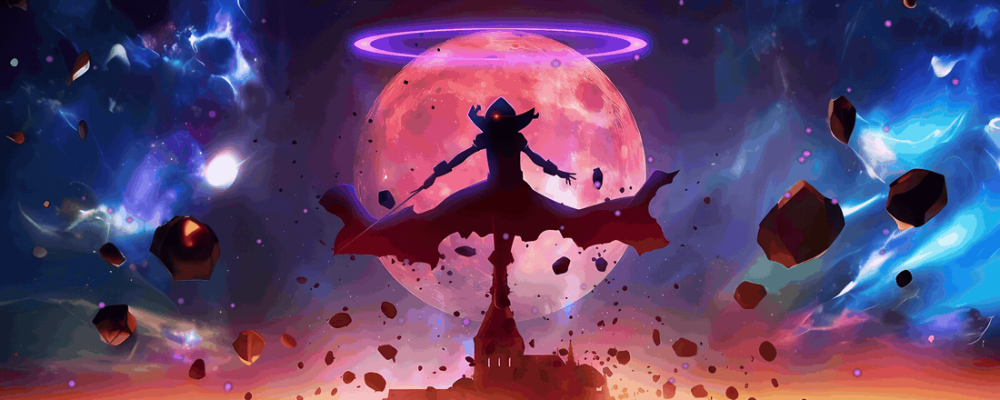
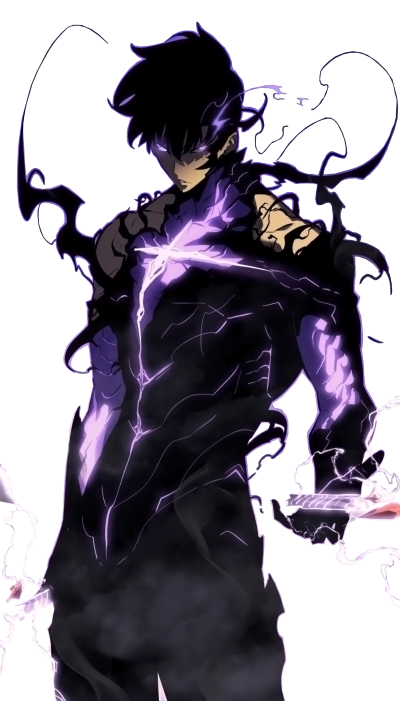
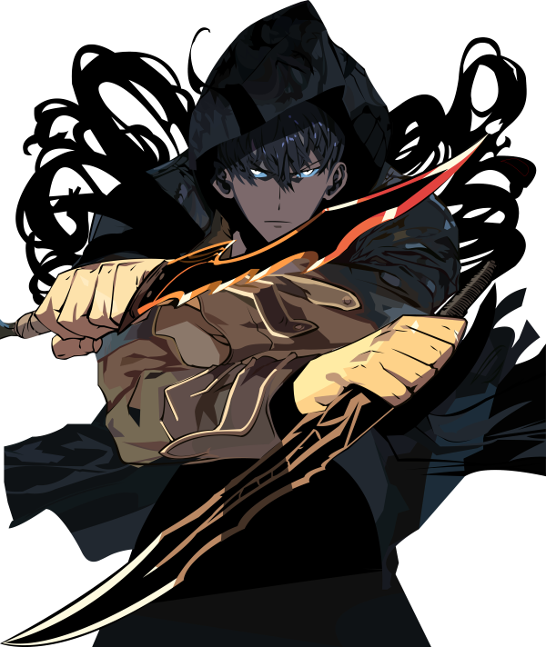

<!-- ===================================================================== -->
<!--  HARILOWJI (HẢI LỢI) — SOLO LEVELING (SUNG JIN-WOO) EDITION          -->
<!-- Inspired by Andrew-Velox's Dark Anime Developer Dashboard Layout      -->
<!-- ===================================================================== -->

  <!-- === HERO BANNER (I AM ATOMIC - THE EMINENCE IN SHADOW WALLPAPER) === -->
  
   

  <!-- === TOP DIVIDER === -->
  <picture>
    <source media="(prefers-color-scheme: dark)" srcset="https://capsule-render.vercel.app/api?type=rect&height=2&color=7B2CBF" />
    <source media="(prefers-color-scheme: light)" srcset="https://capsule-render.vercel.app/api?type=rect&height=2&color=7B2CBF" />
    
  </picture>
   

  <!-- === TYPING NAME (ANDREW-VELOX STYLE) === -->
  <picture>
    <source media="(prefers-color-scheme: dark)"
      srcset="https://readme-typing-svg.demolab.com?font=Geist+Mono&weight=700&size=36&duration=3000&pause=800&color=A855F7&center=true&vCenter=true&width=700&lines=H%E1%BA%A3i+L%E1%BB%A3i+(Harilowji);%5BSYSTEM%5D+PLAYER%3A+SHADOW+MONARCH;ARISE+%E2%80%94+CODE+IN+THE+SHADOWS" />
    <source media="(prefers-color-scheme: light)"
      srcset="https://readme-typing-svg.demolab.com?font=Geist+Mono&weight=700&size=36&duration=3000&pause=800&color=6B21A8&center=true&vCenter=true&width=700&lines=H%E1%BA%A3i+L%E1%BB%A3i+(Harilowji);%5BSYSTEM%5D+PLAYER%3A+SHADOW+MONARCH;ARISE+%E2%80%94+CODE+IN+THE+SHADOWS" />
    
  </picture>

  <!-- === TYPING ROLE === -->
  <picture>
    <source media="(prefers-color-scheme: dark)"
      srcset="https://readme-typing-svg.demolab.com?font=Geist+Mono&weight=500&size=15&duration=2500&pause=1000&color=00B4D8&center=true&vCenter=true&width=650&lines=Software+Engineering+Student+%40+FPTU+%7C+S-Rank+Hunter;AI+Agents+%26+Workflow+Automation+(LangGraph+%E2%80%A2+n8n);Full-Stack+Web+%26+Desktop+Builder+(React+%E2%80%A2+Tauri+%E2%80%A2+C%2B%2B)" />
    <source media="(prefers-color-scheme: light)"
      srcset="https://readme-typing-svg.demolab.com?font=Geist+Mono&weight=500&size=15&duration=2500&pause=1000&color=0284C7&center=true&vCenter=true&width=650&lines=Software+Engineering+Student+%40+FPTU+%7C+S-Rank+Hunter;AI+Agents+%26+Workflow+Automation+(LangGraph+%E2%80%A2+n8n);Full-Stack+Web+%26+Desktop+Builder+(React+%E2%80%A2+Tauri+%E2%80%A2+C%2B%2B)" />
    
  </picture>

   

  <!-- === SOCIAL & CONTACT BADGES === -->
  

    
    &nbsp;
    
    &nbsp;
    
  

 

<!-- ===================================================================== -->
<!--  SYSTEM STATUS WINDOW (ABOUT ME — ANDREW-VELOX TABLE LAYOUT)        -->
<!-- ===================================================================== -->

  <h3>⚡ [SYSTEM NOTIFICATION] — PLAYER STATUS</h3>
  

    
  

| 
🕹️ **Player:** **Hải Lợi (Harilowji)** — *Class: Shadow Monarch of Code*
 |
| :--- |
| 🏛️ **Guild / Academy:** Software Engineering Student @ [FPT University (FPTU)](https://uni.fpt.edu.vn) |
| 🎯 **Main Quests:** AI Agents, Workflow Automation, Full-Stack Web & Desktop Tools |
| ⚔️ **Active Skills Grinding:** `LangGraph` • `n8n` • `Tauri` • `Native C++ / C#` |
| 🌌 **Shadow Army Projects:** [OmniQuiz](https://github.com/Harilowji/OmniQuiz) • [BinBox](https://github.com/Harilowji/BinBox) • [coursera-autopilot-pro](https://github.com/Harilowji/coursera-autopilot-pro) |
| 🏆 **Daily Quest (Off-screen):** Football, Volleyball & cheering for **Manchester United** 🔴 |
| 🎧 **Mana Recovery:** Anime, Lo-Fi beats & clean architecture |
| 📍 **Region:** Vietnam 🇻🇳 |

 

<!-- ===================================================================== -->
<!--  HUNTER ANALYTICS & METRICS (EXACT ANDREW-VELOX DASHBOARD LAYOUT)   -->
<!-- ===================================================================== -->

    
  <!-- Shadow Visitors Counter (Shadow Monarch Purple Theme) -->
  
    
  <!-- GitHub Readme Stats (Auto-generated to .github/assets/stats.svg or Live API) -->
  
   
  <!-- GitHub Streak Stats (Midnight-Purple theme like Andrew-Velox) -->
  
   
  <!-- Lowlighter Metrics Cards (Generated via .github/workflows/metrics.yml) -->
  
  
  

 

<!-- Full-Width Activity Graph (High-Contrast / Shadow Monarch Theme) -->

  

 

<!-- ===================================================================== -->
<!--  SHADOW EXTRACTION: CONTRIBUTION GRID SNAKE                         -->
<!-- ===================================================================== -->

  <picture>
    <source media="(prefers-color-scheme: dark)" srcset="https://raw.githubusercontent.com/Harilowji/Harilowji/output/github-contribution-grid-snake-dark.svg" />
    <source media="(prefers-color-scheme: light)" srcset="https://raw.githubusercontent.com/Harilowji/Harilowji/output/github-contribution-grid-snake.svg" />
    
  </picture>

 

<!-- ===================================================================== -->
<!--  SHADOW ARSENAL: LANGUAGES - FRAMEWORKS - TOOLS                     -->
<!-- (Exact Andrew-Velox 96px Animated Techstack + Skillicons Grid)        -->
<!-- ===================================================================== -->

<h2 align="center">⚔️ Languages - Frameworks - Tools ⚔️</h2>
 

<table align="center">
  <tr>
    <td align="center" width="96">
      
       <b>C++</b>
    </td>
    <td align="center" width="96">
      
       <b>C</b>
    </td>
    <td align="center" width="96">
      
       <b>C#</b>
    </td>
    <td align="center" width="96">
      
       <b>Python</b>
    </td>
    <td align="center" width="96">
      
       <b>Java</b>
    </td>
    <td align="center" width="96">
      
       <b>JavaScript</b>
    </td>
    <td align="center" width="96">
      
       <b>TypeScript</b>
    </td>
  </tr>
  <tr>
    <td align="center" width="96">
      
       <b>React</b>
    </td>
    <td align="center" width="96">
      
       <b>Node.js</b>
    </td>
    <td align="center" width="96">
      
       <b>Tauri</b>
    </td>
    <td align="center" width="96">
      
       <b>Electron</b>
    </td>
    <td align="center" width="96">
      
       <b>Tailwind</b>
    </td>
    <td align="center" width="96">
      
       <b>MySQL</b>
    </td>
    <td align="center" width="96">
      
       <b>Docker</b>
    </td>
  </tr>
  <tr>
    <td align="center" width="96">
      
       <b>Git</b>
    </td>
    <td align="center" width="96">
      
       <b>GitHub</b>
    </td>
    <td align="center" width="96">
      
       <b>VS Code</b>
    </td>
    <td align="center" width="96">
      
       <b>Linux</b>
    </td>
    <td align="center" width="96">
      
       <b>HTML5</b>
    </td>
    <td align="center" width="96">
      
       <b>CSS3</b>
    </td>
    <td align="center" width="96">
      
       <b>AI Agents</b>
    </td>
  </tr>
</table>

 

<!-- ===================================================================== -->
<!--  COMPETITIVE PROGRAMMING / DUNGEON RAIDS (LEETCODE STATS)           -->
<!-- ===================================================================== -->

  <h2 align="center">⚔️ Competitive Programming & Dungeon Raids ⚔️</h2>
   
  

 

<!-- ===================================================================== -->
<!--  FOOTER                                                             -->
<!-- ===================================================================== -->

<h4 align="center">
  "ARISE." — Crafted in the Shadows with  by <a href="https://github.com/Harilowji">Harilowji (Hải Lợi)</a>
</h4>
